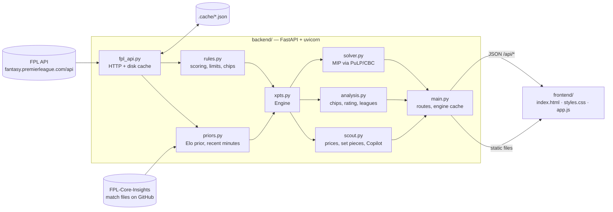

# Architecture

Mug's Game FC is two pieces in one process: a FastAPI backend that does all the
maths, and a static single-page app it serves from `/`.

## Request life cycle

1. The browser calls an `/api/*` route (see `API.md`).
2. `main.engine()` returns the cached `xpts.Engine`, rebuilding it when it is
   older than `ENGINE_TTL` (900 s). A rebuild:
   - reads `bootstrap-static` and `fixtures` through `fpl_api`;
   - builds a cheap probe engine to learn the current gameweek;
   - fetches the Elo prior (`priors.fetch_elo` → `elo_strength`) and the last six
     gameweeks of `/event/{gw}/live/` (`priors.fetch_recent_live`); either can fail
     and the engine falls back gracefully;
   - builds the real engine and calls `solver.configure(engine.rules)` so the
     solver adopts this season's squad and transfer limits.
3. `main.rows_for(horizon)` memoises projections for every player at that
   horizon. Minute overrides from the client produce a fresh, uncached set.
4. The route hands rows to the solver, the analysis module or the scout module
   and returns JSON.

## Caching

| Layer | Where | Lifetime |
| --- | --- | --- |
| FPL responses | `.cache/<key>.json` | per endpoint: bootstrap 900 s, fixtures 900 s, entry 300 s, picks 300 s, history 600 s, live 120 s, finished live 6 h, standings 600 s, element summary 1800 s |
| Stale fallback | same file | served when the API fails, however old |
| Engine | process memory | 900 s |
| Projection rows | process memory, per (gw, horizon) | until the engine rebuilds |
| Elo prior | `.cache/elo_prior.json` | per season/gameweek |

`FPL_CACHE_ONLY=1` turns the network off entirely: anything not cached raises,
which routes turn into 404/503 responses.

## Startup

`/healthz` answers immediately so Railway's health check passes; an
`on_event("startup")` hook warms the engine in a background thread. The first
API request after boot may wait for that warm-up.

## Frontend

No build, no framework, no CDN. `index.html` holds the shell (top bar, the neon
sky, the dock, the landing screen and its pitch scene, the logo). `app.js`
defines five tabs and their sub-pages in `TABS` and routes by hash
(`#home/squad`, `#plan/chips`, `#players/compare` …; old addresses like
`#solver` are mapped in `LEGACY`). Each sub-page is a view function that fetches
its data and renders HTML strings into its own `<section>`. `motion.js` wraps the
vendored GSAP and anime.js; a `MutationObserver` animates new cards in as views
render. State that survives a reload lives in `localStorage` under `fplai_*`
keys (team ID, team name, minute overrides, last league). A saved team ID skips
the landing screen; `loadSavedTeam()` reads it fresh (`fresh=1`) and team views
`await teamReady()` before their own requests. See `DESIGN.md` for the visual
system and motion.

## Freshness (cache policy)

Every open must show the latest design and the latest squad, including
home-screen apps that iOS keeps alive for days. `main.py` handles it with no
build step:

| What | Header / behaviour |
| --- | --- |
| `/` (index.html) | `Cache-Control: no-store, no-cache, must-revalidate, max-age=0` (+ `Pragma`, `Expires`). The browser never keeps its own copy, so a refresh always fetches the page afresh, and back/forward doesn't resurrect a stale one |
| `/static/*.css`, `/static/*.js` (sub-folders too, e.g. `/static/vendor/gsap.min.js`) | the server rewrites their links in index.html to `?v=<sha256[:12]>` of the file; those URLs are `immutable`, cached for a year. Reloads stay fast and are still always current, because the hash in the page changes with the file |
| other `/static/*` (icon, manifest) | `no-cache` |
| `/api/*` | `no-store` (same full set as the page) |
| `/version` | `{"build": "<id>"}`, `no-store` |

Data is fresh too. The FPL responses behind a manager (`entry`, `history`,
`picks`, `transfers`) are cached server-side for minutes. The first read of your
team after each page load is `GET /api/entry/{id}?fresh=1`, which expires those
files (`fpl_api.refresh_team`; the old copy stays as a fallback if FPL is down)
so a transfer made on the FPL site shows up on refresh. Purges are throttled to
one per team per 20 seconds. The app does the same quietly (`softRefresh`) when
you come back after ten minutes away, and **More → Refresh app** does a full
reload for home-screen apps that have no reload button. All `fetch` calls from
`app.js` use `cache: 'no-store'`.

The page carries `<meta name="app-build">`. `app.js` calls `/version` when the app
returns to the foreground (`visibilitychange`, `focus`), at most once a minute,
and reloads if the build has changed. A page restored from the back/forward
cache is reloaded straight away. The
hashes are recomputed whenever a file's mtime or size changes, so local edits
show up on reload without restarting the server.

## Why these choices

- **Rules from bootstrap-static.** FPL changes scoring between seasons (the
  10-point goalkeeper goal arrived in 2026/27). Reading the rules means a new
  season needs no code change.
- **MIP over heuristics.** Transfers interact across weeks — a hit now can
  enable two good moves later. Only a joint optimisation sees that.
- **No build step.** The app is small enough that a bundler would cost more
  than it saves, and anyone can edit it in place.
